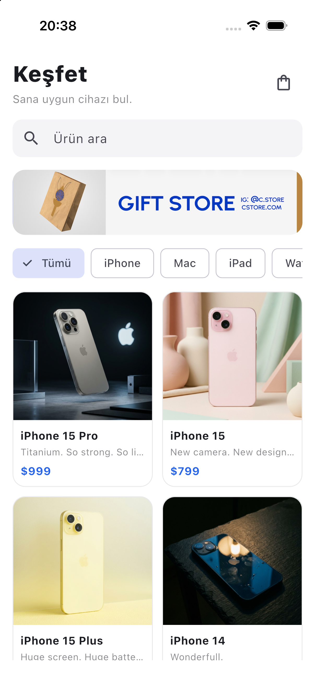
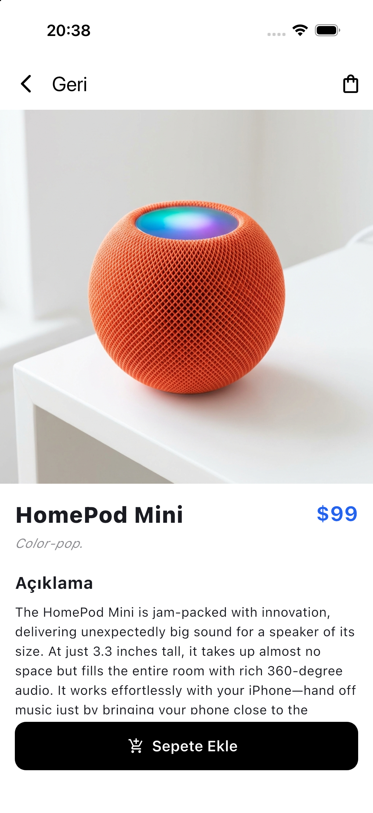
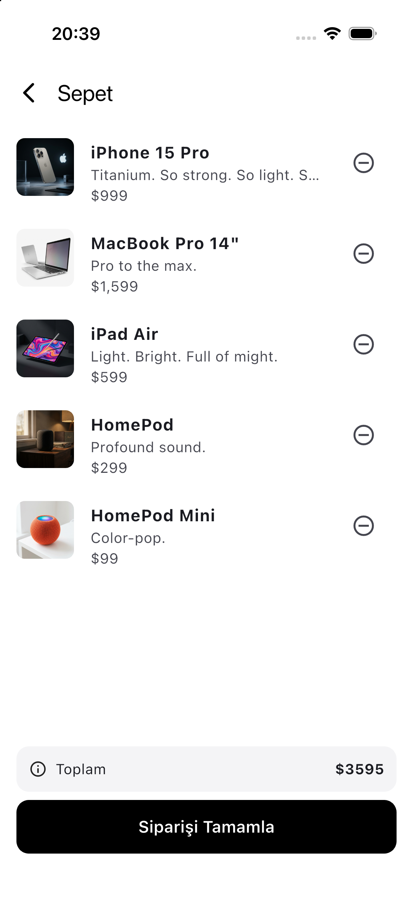
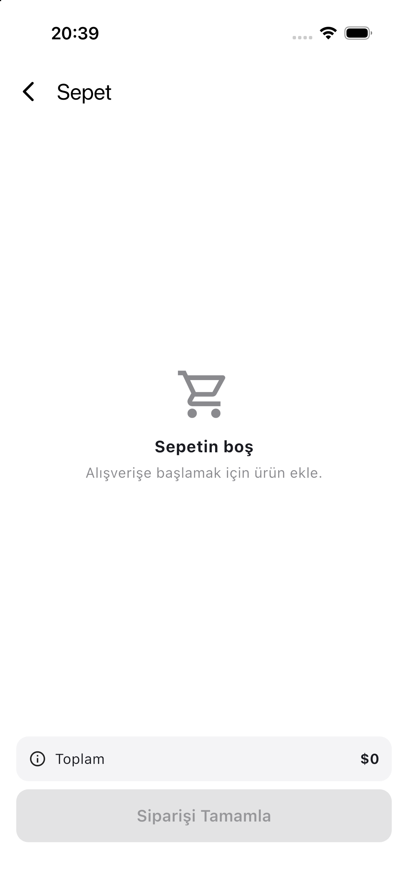

# Mini Katalog

Flutter eğitimi kapsamında geliştirilen basit bir ürün kataloğu uygulaması. Ürünleri listeler, arama ve kategoriye göre süzer, ürün detayını gösterir ve sepet işlemlerini simüle eder.

## Ekran görüntüleri

| Ana sayfa | Ürün detayı | Sepet | Boş sepet |
| --- | --- | --- | --- |
|  |  |  |  |

## Özellikler

- `GridView` ile kart tabanlı ürün listesi
- Ürün adına göre arama ve kategori filtresi
- Named route ile sayfa geçişleri, ürünün detay sayfasına route argument olarak taşınması
- Sepete ekleme, çıkarma, toplam tutar ve sipariş simülasyonu
- Ürünlerin `assets/data/products.json` dosyasından model sınıfına (`fromJson` / `toJson`) okunması
- Yalnızca `material.dart`; ek paket kullanılmadı

## Kullanılan sürüm

- Flutter 3.47.7 (stable)
- Dart 3.13.5

## Çalıştırma adımları

1. Flutter SDK'yı kurun: <https://docs.flutter.dev/get-started/install>
2. Depoyu indirin ve klasöre girin:

   ```bash
   git clone <repo-url>
   cd mini-katalog
   ```

3. Bağımlılıkları yükleyin:

   ```bash
   flutter pub get
   ```

4. Bir emülatör açın veya cihaz bağlayın, sonra uygulamayı başlatın:

   ```bash
   flutter run
   ```

Testleri çalıştırmak için: `flutter test`

## Klasör yapısı

```
lib/
  main.dart                  Uygulama girişi
  routes.dart                Named route tanımları
  models/product.dart        Ürün modeli
  data/product_repository.dart   JSON'dan ürün okuma
  state/cart.dart            Sepet durumu
  screens/                   Ana sayfa, ürün detayı, sepet
  widgets/product_card.dart  Ürün kartı
  theme/app_theme.dart       Renk ve stil ayarları
assets/
  data/products.json         Ürün verisi
  images/                    Ürün görselleri ve banner
```

## Veri kaynağı

Ürün verisi ve görseller eğitim ve demo amaçlıdır; [wantapi.com](https://wantapi.com/products.php) adresinden alınıp projeye asset olarak eklenmiştir. Gerçek bir e-ticaret altyapısını temsil etmez. Ürün adları ve markalar sahiplerine aittir.
